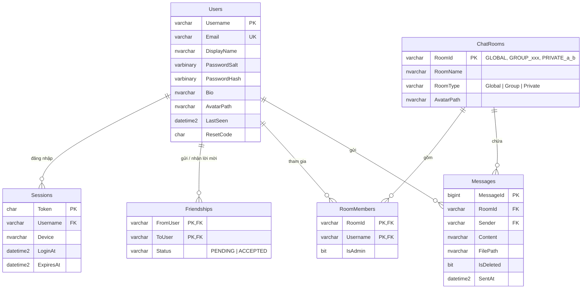

# WebService + Database cho Zalu (Nhóm 17)

Làm theo kiến trúc trong nội dung thuyết trình (mục 1.3):

```
ClientForm (WinForms)  ──HTTP + JSON──▶  WebService (ASP.NET Core Web API)  ──ADO.NET──▶  SQL Server (ZaluChat)
```

Phần mới được viết để khớp với code đang có trên GitHub:

| Code hiện có | Trong WebService / Database |
|---|---|
| `UserAccount` (Username, Email, DisplayName, PasswordSalt, PasswordHash) | Bảng `Users`, đúng tên cột |
| `AccountService.Register/Login`: luật username 3–32 ký tự, mật khẩu 8–128 ký tự, PBKDF2 100.000 vòng, salt 16 byte | `Infrastructure/Rules` + `PasswordHasher`, cùng luật, cùng cách băm |
| Mã kết quả `USERNAME_EXISTS`, `INVALID_CREDENTIALS`, `INVALID_PASSWORD`… | Trả về trong JSON `{"code": "...", "message": "..."}` |
| `ChatRoom` + `ChatRoomType` (Global, Group, Private), phòng `GLOBAL` "Nhóm chat tổng" | Bảng `ChatRooms` + `RoomMembers`; đăng ký/đăng nhập tự vào `GLOBAL` |
| `UserSession` (Username, LoginAt) | Bảng `Sessions` (token đăng nhập) |
| `ChatClientManager.Client` | `ApiClientManager.Api` (thêm file `ClientForm/ApiClient.cs`) |

## Thêm vào repo

Chép vào thư mục gốc repo `Group17_ChatApp`:

```
Group17_ChatApp/
├── ChatappZalu.slnx              (đã thêm dòng WebService/WebService.csproj)
├── ClientForm/
│   └── ApiClient.cs              ← MỚI: gọi WebService từ WinForms
├── Server/                       (giữ nguyên)
├── Database/
│   └── ZaluChat.sql              ← MỚI: tạo database + 6 bảng
├── WebService/                   ← MỚI: project ASP.NET Core Web API
├── Postman/
│   └── ZaluChat.postman_collection.json   ← MỚI: kiểm thử API
└── HUONG_DAN_WEBSERVICE.md
```

## Chạy thử

1. **Tạo database:** mở `Database/ZaluChat.sql` trong SSMS rồi nhấn **Execute (F5)**.
2. **Chuỗi kết nối:** mở `WebService/appsettings.json`, sửa `ConnectionStrings:ZaluChat` nếu cần.
   - Mặc định: `Server=localhost;...;Trusted_Connection=True` (đăng nhập Windows).
   - SQL Express: `Server=localhost\SQLEXPRESS;Database=ZaluChat;Trusted_Connection=True;TrustServerCertificate=True`
   - Tài khoản sa: `Server=localhost;Database=ZaluChat;User Id=sa;Password=...;TrustServerCertificate=True`
3. **Chạy WebService:** trong Visual Studio chuột phải `WebService` → **Set as Startup Project** → F5. Hoặc mở terminal:
   ```bash
   cd WebService
   dotnet run
   ```
   Lần đầu sẽ tự tạo tài khoản mẫu **alice / bob / carol**, mật khẩu **12345678**, đã là bạn bè, có nhóm "Nhóm đồ án NT106".
4. **Thử bằng Postman:** Import `Postman/ZaluChat.postman_collection.json` → gửi **1. Tài khoản → Đăng nhập (alice)** trước. Token tự lưu vào biến `{{token}}`, các yêu cầu khác dùng được ngay.

Máy khác trong LAN gọi API qua `http://<IP máy chạy WebService>:5000` (mở cổng 5000 trên Windows Firewall).

## Cơ sở dữ liệu (6 bảng)



## Các API (ứng với 6 nhóm chức năng)

Mọi yêu cầu (trừ đăng ký, đăng nhập, quên mật khẩu) phải có header `Authorization: Bearer <token>`. Lỗi trả về dạng `{"code":"USERNAME_EXISTS","message":"Tên đăng nhập đã tồn tại."}`.

| Nhóm chức năng | Phương thức | Đường dẫn | Dữ liệu gửi |
|---|---|---|---|
| **1. Tài khoản** | POST | `/api/auth/register` | `{username, email, password, displayName?}` |
| | POST | `/api/auth/login` | `{username, password, device?}` → `{token, username, displayName, email}` |
| | POST | `/api/auth/logout` | |
| | POST | `/api/auth/forgot-password` | `{email}`, mã 6 số gửi qua email (chưa cấu hình SMTP thì in ra console) |
| | POST | `/api/auth/reset-password` | `{email, code, newPassword}` |
| | PUT | `/api/auth/password` | `{oldPassword, newPassword}` |
| | PUT | `/api/users/me` | `{displayName, bio}` |
| **2. Bạn bè** | GET | `/api/users/search?q=` | kèm quan hệ: FRIEND / SENT / RECEIVED / NONE |
| | POST | `/api/friends/requests/{username}` | gửi lời mời |
| | POST | `/api/friends/requests/{username}/accept` | chấp nhận |
| | DELETE | `/api/friends/requests/{username}` | từ chối / huỷ lời mời |
| | GET | `/api/friends` | danh sách bạn (Online trước) |
| | DELETE | `/api/friends/{username}` | xoá bạn |
| **3. Tin nhắn** | GET | `/api/rooms/{roomId}/messages` | `?afterId=` tin mới, `?beforeId=` tin cũ |
| | POST | `/api/rooms/{roomId}/messages` | `{content}` |
| | POST | `/api/rooms/{roomId}/files` | form-data `file`, `content?` (hình ảnh / tệp) |
| | DELETE | `/api/messages/{messageId}` | xoá tin của mình |
| **4. Nhóm chat** | GET | `/api/rooms` | các phòng của tôi + tin cuối |
| | POST | `/api/rooms/group` | `{roomName, members: [...]}` |
| | POST | `/api/rooms/private/{username}` | mở chat riêng |
| | PUT | `/api/rooms/{roomId}/name` | `{roomName}` (trưởng nhóm) |
| | POST | `/api/rooms/{roomId}/members` | `{username}` (trưởng nhóm) |
| | DELETE | `/api/rooms/{roomId}/members/{username}` | (trưởng nhóm) |
| | POST | `/api/rooms/{roomId}/leave` | rời nhóm |
| **5. Trạng thái** | POST | `/api/users/me/heartbeat` | gọi 30 giây/lần; Online = gọi API trong 60 giây gần nhất |
| **6. Cài đặt** | POST | `/api/users/me/avatar` | form-data `file` |
| | PUT | `/api/users/me/email` | `{newEmail, password}` |
| | GET | `/api/auth/sessions` | các thiết bị đang đăng nhập |
| | DELETE | `/api/auth/sessions/others` | đăng xuất thiết bị khác |

## Nối vào ClientForm

`ClientForm/ApiClient.cs` có sẵn hàm cho từng API. Ví dụ sửa `Login.cs`, thay cho `ConnectAsync` + `SendLineAsync("LOGIN|...")`:

```csharp
private async void btn_Login_Click(object sender, EventArgs e)
{
    btn_Login.Enabled = false;
    try
    {
        var me = await ApiClientManager.Api.LoginAsync(txtb_Username.Text.Trim(), txtbox_Password.Text);
        MessageBox.Show("Đăng nhập thành công!", "Zalu");
        Hide();
        new GiaoDien().ShowDialog();
        Close();
    }
    catch (ApiException ex)
    {
        string message = ex.Code switch
        {
            "INVALID_CREDENTIALS" => "Sai tên đăng nhập hoặc mật khẩu.",
            "CANNOT_CONNECT" => "Không kết nối được máy chủ.",
            _ => ex.Message
        };
        MessageBox.Show(message, "Zalu", MessageBoxButtons.OK, MessageBoxIcon.Warning);
    }
    finally
    {
        btn_Login.Enabled = true;
    }
}
```

`Register.cs`: `await ApiClientManager.Api.RegisterAsync(username, email, password);` và bắt `ApiException` với `ex.Code` là `USERNAME_EXISTS`, `EMAIL_EXISTS`, `INVALID_USERNAME`, `INVALID_PASSWORD`… như `switch` đang có.

**Nhận tin nhắn mới:** Web API chỉ trả lời khi được hỏi, nên `GiaoDien` dùng `System.Windows.Forms.Timer` hỏi định kỳ (polling):

```csharp
private string currentRoomId = "GLOBAL";
private long lastMessageId = 0;
private readonly System.Windows.Forms.Timer pollTimer = new() { Interval = 1500 };    // 1,5 giây
private readonly System.Windows.Forms.Timer heartbeatTimer = new() { Interval = 30000 };

private async Task OpenRoomAsync(string roomId)
{
    currentRoomId = roomId;
    var messages = await ApiClientManager.Api.GetLatestMessagesAsync(roomId);
    // hiển thị messages ...
    lastMessageId = messages.Count > 0 ? messages[^1].MessageId : 0;
}

// Trong constructor GiaoDien:
//   pollTimer.Tick += async (s, e) => await PollAsync();      pollTimer.Start();
//   heartbeatTimer.Tick += async (s, e) => await ApiClientManager.Api.HeartbeatAsync();   heartbeatTimer.Start();
private async Task PollAsync()
{
    pollTimer.Stop();
    try
    {
        var newMessages = await ApiClientManager.Api.GetNewMessagesAsync(currentRoomId, lastMessageId);
        foreach (var m in newMessages)
        {
            // thêm m.SenderName + ": " + m.Content vào khung chat
            lastMessageId = m.MessageId;
        }
    }
    catch (ApiException) { /* mất mạng: lần sau thử lại */ }
    finally { pollTimer.Start(); }
}
```

Timer của WinForms chạy trên luồng giao diện, nên cập nhật control trực tiếp được, không cần `Invoke`.

## Ghi chú

- Project `Server/` (TCP) vẫn giữ nguyên để tham khảo; WebService là phần thay thế theo kiến trúc đã trình bày.
- Ảnh và tệp lưu tại `WebService/wwwroot/uploads/`; đường dẫn trả về dạng `/uploads/files/abc.png`, ghép với `ApiClient.FileUrl(...)` để hiển thị.
- Thời gian dùng giờ của máy SQL Server (`SYSDATETIME()`).
- Muốn tin đến tức thời thay vì polling: có thể thêm SignalR sau, các API hiện có không phải sửa.
